  

  
  
  
  

- 🚀 Just shipped **two ML services to deployment** as an MLOps intern at **Safaricom** (May–Oct 2026), plus pipeline jobs for a churn survival model on M-PESA, Kenya's mobile-money service

- 🏆 **3rd place**, Safaricom Interns AI/ML Hackathon 2026: ML engineer on Team Sixth Sense, building *SafeUndo* to protect mobile-money users from mistaken or fraudulent transfers

- 🔬 Latest research: **[EvidenceGuard](https://github.com/254Nicole-Nase/evidence-guard)**. An NLI cross-encoder caught RAG hallucinations far better than embedding similarity (**0.72 vs 0.57 AUROC**, 69,217 sentences)

- 🎓 BSc Informatics & Computer Science, **Strathmore University** (2026)

- 💼 Looking for **graduate roles in ML, MLOps and AI engineering**. Available now, open to relocate (needs visa sponsorship)

- 💬 Ask me about **ML pipelines, RAG and evals, deploying models, and AI for Kiswahili speakers**

- 🗣️ Kiswahili (native) · English (fluent) · 日本語 (learning)

- ⚡ Fun fact: **I'm an introverted, fantasy-loving girl who enjoys football and jamming to J-pop and punk rock when I'm not debugging code!**

### 🛠️ Things I've built

| | Project | What it does | Try it |
|---|---|---|---|
| ⚖️ | **HakiMtaani** | Free legal help for Kenyan tenants and workers in English, Kiswahili or Sheng. 13 legal rules as tested code, so the AI never does the maths. | [Live](https://hakimtaani.vercel.app) · [Code](https://github.com/254Nicole-Nase/hakimtaani) |
| 💊 | **Drug Info Center** | RAG assistant that cites every answer to FDA label text and refuses unsafe questions. | [Live](https://drug-information-base.vercel.app/) · [Code](https://github.com/254Nicole-Nase/Drug-Information-Base) |
| 🥗 | **The Price of a Healthy Plate** | Why 76.3% of Kenyans can't afford a healthy diet, mapped across 168 countries. | [Dashboard](https://254Nicole-Nase.github.io/price-of-a-healthy-plate/) · [Code](https://github.com/254Nicole-Nase/price-of-a-healthy-plate) |
| 📚 | **SomaRec** | Find Kenyan books by what they're about. Hybrid search: right book first 72% → 98%. | [Live](https://soma-rec-thematic-recommender.vercel.app/) · [Code](https://github.com/254Nicole-Nase/somaRec-thematic-recommender) |
| 🤖 | **BizOps Standup Agent** | Notion tracker → weekly Slack brief. Code scores the risk, the LLM writes, quality gates check it. | [Live](https://bizops-standup-agent.onrender.com) · [Code](https://github.com/254Nicole-Nase/BizOps-Standup-Agent-) |

### 🧰 Tools I use

  

Plus Spark, MLRun, SonarQube, LiteLLM, FAISS, pgvector and Sentence Transformers.

### 📊 GitHub stats

  
  

### 🤝 Connect with me

